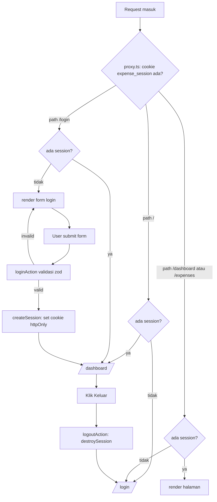

# Autentikasi Expense Manager

Dokumen ini menjelaskan alur autentikasi yang sedang dibangun di proyek ini,
peran setiap file, serta batas-batas (boundary) yang perlu dipahami.

> **Disclaimer:** autentikasi di proyek ini adalah **simulasi untuk pembelajaran**.
> Tidak ada backend nyata, tidak ada penyimpanan/pengecekan credential, dan cookie
> session tidak ditandatangani. Jangan dipakai sebagai pola keamanan produksi.

---

## 1. Ringkasan

Sistem ini hanya menjawab satu pertanyaan: **"user sudah login atau belum?"**

Caranya: setelah login berhasil (validasi format saja), server menulis cookie
`httpOnly` berisi data user demo. Keberadaan cookie itu dipakai oleh `proxy.ts`
untuk mengizinkan atau mengalihkan akses ke halaman tertentu.

- **Tidak ada** verifikasi password ke database.
- **Tidak ada** token bertanda tangan (signed token).
- **Tidak ada** penyimpanan session di server; session "disimpan" di cookie.

---

## 2. Peta file baru

| File | Jenis | Tanggung jawab |
|---|---|---|
| `src/lib/session.ts` | modul netral | Konstanta nama cookie (`SESSION_COOKIE = 'expense_session'`). |
| `src/lib/auth.ts` | modul server-only | `createSession`, `destroySession`, `getSession`, `isAuthenticated`, tipe `SessionUser`, `DEMO_USER`. Baca/tulis cookie. |
| `src/app/(auth)/login/actions.ts` | server action (`'use server'`) | Validasi input login (zod), panggil `createSession`, redirect ke `/dashboard`. |
| `src/app/(auth)/login/page.tsx` | client component (`'use client'`) | Form login, memanggil `loginAction` via `useActionState`, menampilkan error. |
| `src/app/(auth)/logout/actions.ts` | server action (`'use server'`) | `destroySession`, redirect ke `/login`. |
| `src/app/dashboard/page.tsx` | server component | Halaman terlindungi (placeholder) + tombol logout. |
| `src/proxy.ts` | proxy (pengganti `middleware` Next 16) | Route guard: cek cookie, redirect sebelum route dirender. |
| `src/app/page.tsx` | server component | Fallback statis `/` → `redirect('/login')`. |
| `src/app/(auth)/` | route group | Pengelompokan halaman/aksi auth. Tanda `(auth)` tidak muncul di URL. |

---

## 3. Diagram alur



---

## 4. Penjelasan tiap file

### 4.1 `src/lib/session.ts`

```ts
export const SESSION_COOKIE = 'expense_session';
```

Satu-satunya sumber nama cookie. Dipakai oleh `auth.ts` (server) dan `proxy.ts`
(sebelum render). Memisahkan konstanta ini mencegah import melingkar dan salah
ketik nama cookie.

- Netral, boleh diimpor di server maupun proxy.

### 4.2 `src/lib/auth.ts`

Modul **server-only** karena memakai `cookies()` dari `next/headers`.

| Export | Maksud |
|---|---|
| `SESSION_COOKIE` | Re-export nama cookie. |
| `SessionUser` | `{ email, name, tenantId }`. `tenantId` disiapkan untuk isolasi data multi-tenant. |
| `DEMO_USER` | Akun demo statis dengan `tenantId: 'tenant-demo'`. Email apa pun dipetakan ke tenant yang sama. |
| `createSession(email)` | Menyimpan user demo + email ke cookie `httpOnly`, `sameSite: 'lax'`, `path: '/'`, `maxAge: 8 jam`. |
| `destroySession()` | Menghapus cookie session. |
| `getSession()` | Membaca + `JSON.parse` cookie; `null` bila tidak ada/rusak. |
| `isAuthenticated()` | `getSession() !== null`. |

Catatan keamanan (lihat juga komentar di file):

- Cookie **tidak ditandatangani** → isinya dapat dipalsukan klien.
- **Tidak ada** pengecekan credential/password.
- Di produksi: verifikasi password terhadap hash (argon2/bcrypt), simpan session
  sebagai token bertanda tangan, dan verifikasi ulang di server.

### 4.3 `src/app/(auth)/login/actions.ts`

- `'use server'` → server action yang dapat dipanggil dari client.
- `loginSchema` (zod): `email` valid, `password` minimal 6 karakter.
- `LoginState`: `{ error?, fieldErrors? }`.
- `loginAction(prev, formData)`:
  1. `safeParse` `email` + `password` dari `FormData`.
  2. Bila gagal → kumpulkan error per field, kembalikan `{ error, fieldErrors }`.
  3. Bila valid → `createSession(email)` lalu `redirect('/dashboard')`.

`redirect()` melempar error khusus, sehingga tidak memerlukan `return` setelahnya.

### 4.4 `src/app/(auth)/login/page.tsx`

- `'use client'` karena memakai hook.
- `useActionState(loginAction, initialState)` → `[state, formAction]`.
- `useFormStatus()` di `SubmitButton` → disabled + teks "Memproses..." saat pending.
- Menampilkan `state.fieldErrors.email`, `state.fieldErrors.password`, `state.error`.
- Nilai default form: email `demo@gmail.com`, password `demo`.

> **Bug yang diketahui:** default password `demo` hanya 4 karakter, sedangkan
> validasi mensyaratkan minimal 6. Submit form bawaan langsung memunculkan
> "Password minimal 6 karakter". Perbaikan: ganti default menjadi `demo123`
> (atau kosongkan dan tampilkan petunjuk).

### 4.5 `src/app/(auth)/logout/actions.ts`

- `'use server'`.
- `logoutAction()`: `destroySession()` lalu `redirect('/login')`.

### 4.6 `src/app/dashboard/page.tsx`

- Server component tanpa directive.
- Placeholder "Login berhasil" + form tombol "Keluar" yang memanggil `logoutAction`.
- Halaman ini **tidak** mengecek session sendiri; proteksinya bergantung pada `proxy.ts`.

### 4.7 `src/proxy.ts`

Di Next.js versi ini, konvensi `middleware` sudah **deprecated** dan diganti
`proxy.ts` dengan export `proxy` (lihat `node_modules/next/dist/docs/.../proxy.md`).

Logika:

- `hasSession` = cookie `expense_session` ada (hanya keberadaan, bukan validitas).
- `/` → `/dashboard` bila ada session, selain itu `/login`.
- `/dashboard/*` atau `/expenses/*` tanpa session → `/login`.
- `/login` dengan session → `/dashboard`.
- Selain itu → `NextResponse.next()`.

`config.matcher = ['/', '/dashboard/:path*', '/expenses/:path*', '/login']`.

Catatan:

- Proxy berjalan sebelum render dan idealnya ringan; docs menyarankan tidak
  bergantung pada modul/global bersama. Karena itu proxy hanya membaca cookie
  lewat `SESSION_COOKIE`, bukan mengimpor `auth.ts` (yang memakai `cookies()`).
- Cookie palsu dianggap sesi valid → batas keamanan simulasi, bukan auth nyata.

### 4.8 `src/app/page.tsx`

Halaman default Next.js dihapus, diganti `redirect('/login')`. Tujuannya agar
`cookies()` tidak dipanggil saat prerender (proyek memakai `cacheComponents: true`).
Keputusan login/tidak-login yang sebenarnya tetap ditangani `proxy.ts`.

### 4.9 Route group `(auth)`

Tanda kurung membuatnya **route group**: tidak muncul di URL.
`(auth)/login` → `/login`; `(auth)/logout/actions.ts` bukan route (hanya file aksi).
Fungsinya mengelompokkan kode auth agar terpisah dari `dashboard/`.

---

## 5. Boundary (batas-batas penting)

### 5.1 Server vs Client

| Konteks | Ditandai oleh | Contoh |
|---|---|---|
| Server action | `'use server'` | `loginAction`, `logoutAction` |
| Client component | `'use client'` | `login/page.tsx` |
| Server component | default (tanpa directive) | `dashboard/page.tsx` |

Cookie hanya boleh dibaca/ditulis di server (`next/headers`). Komponen client
tidak menyentuh cookie; ia hanya memanggil server action.

### 5.2 Public vs Protected route

| Route | Akses |
|---|---|
| `/login` | Publik (redirect ke `/dashboard` bila sudah login) |
| `/` | Dialihkan oleh proxy |
| `/dashboard/*` | Protected |
| `/expenses/*` | Protected |

Proteksi dijalankan oleh `proxy.ts` berdasarkan matcher.

### 5.3 Trust / keamanan

Batas kepercayaan (trust boundary) saat ini **lemah dan disengaja**:

- Cookie dapat dimodifikasi/dipalsukan klien.
- Proxy hanya memeriksa keberadaan cookie, bukan keabsahannya.
- Tidak ada signature, tidak ada verifikasi password.

Konsekuensi: siapa pun yang menulis cookie `expense_session` akan dianggap login.
Untuk produksi, batas ini harus diperkuat (signed/encrypted session, verifikasi
server, CSRF/`sameSite`, rotasi session, dsb.).

### 5.4 Session vs Tenant

`SessionUser` menyertakan `tenantId`. Saat ini hanya ada demo tenant (`tenant-demo`)
dan belum dipakai untuk memfilter data. Nantinya `tenantId` menjadi batas isolasi
data antar-pemilik di lapisan repository/query.

### 5.5 Rendering

`next.config.ts` memakai `cacheComponents: true`, sehingga halaman yang memanggil
`cookies()` bersifat dinamis. `page.tsx` sengaja statis (hanya redirect) agar build
tidak gagal saat prerender.

---

## 6. Skenario pengujian manual

1. **Belum login**, buka `/` → diarahkan ke `/login`.
2. Buka `/dashboard` langsung → diarahkan ke `/login`.
3. Submit login dengan email tidak valid → muncul error di field email.
4. Submit login dengan password < 6 karakter → muncul error di field password.
5. Submit login valid (`demo@gmail.com` + minimal 6 karakter) → diarahkan ke `/dashboard`.
6. Saat sudah login, buka `/login` → diarahkan ke `/dashboard`.
7. Klik "Keluar" → cookie terhapus → kembali ke `/login`; `/dashboard` kembali terblokir.
8. Setelah logout, coba `/dashboard` lagi → diarahkan ke `/login`.

---

## 7. Keterbatasan & langkah menuju produksi

- [ ] Ganti simulasi dengan verifikasi password terhadap hash (argon2/bcrypt).
- [ ] Simpan session sebagai token bertanda tangan / server-side session store.
- [ ] Verifikasi session di server (bukan hanya keberadaan cookie di proxy).
- [ ] Tambahkan masa berlaku + rotasi session, dan penanganan logout di semua device.
- [ ] Pastikan `httpOnly`, `secure`, `sameSite` sesuai lingkungan.
- [ ] Terapkan `tenantId` untuk isolasi data multi-tenant.
- [ ] Perbaiki default password form (`demo` → `demo123`).

---

## 8. Referensi

- `node_modules/next/dist/docs/01-app/03-api-reference/03-file-conventions/proxy.md`
- `node_modules/next/dist/docs/01-app/03-api-reference/03-file-conventions/middleware.md`
- Kode sumber: `src/lib/`, `src/app/(auth)/`, `src/proxy.ts`
